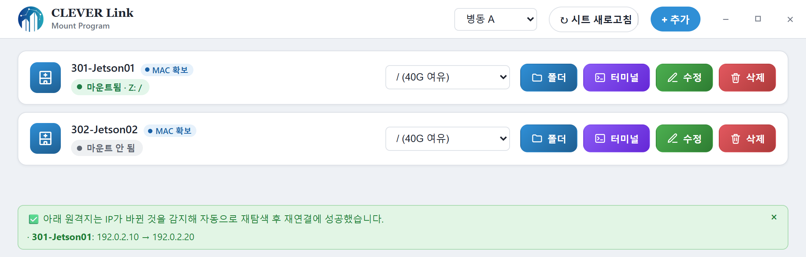
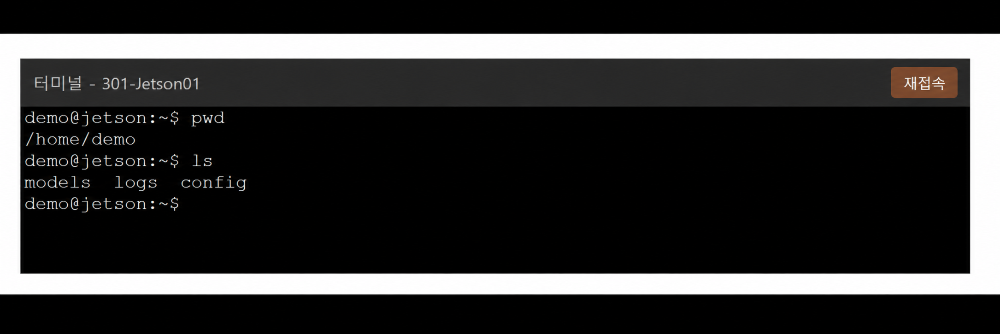
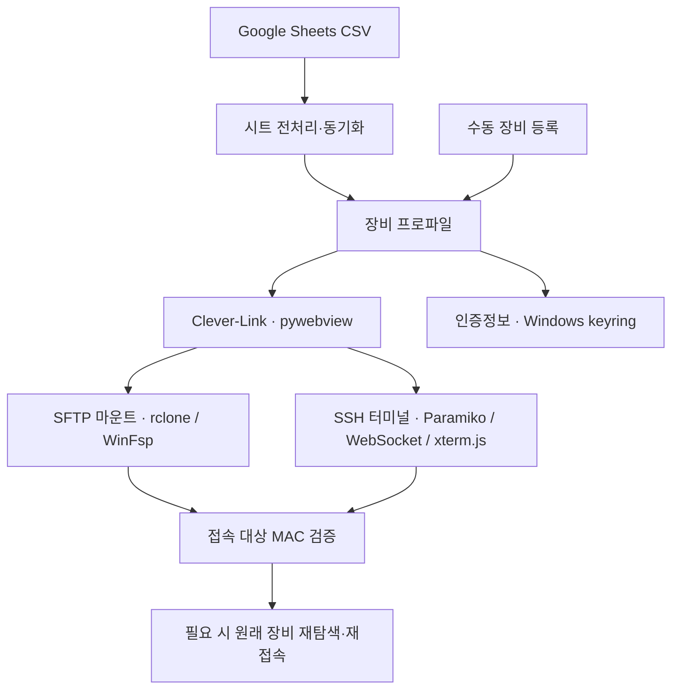
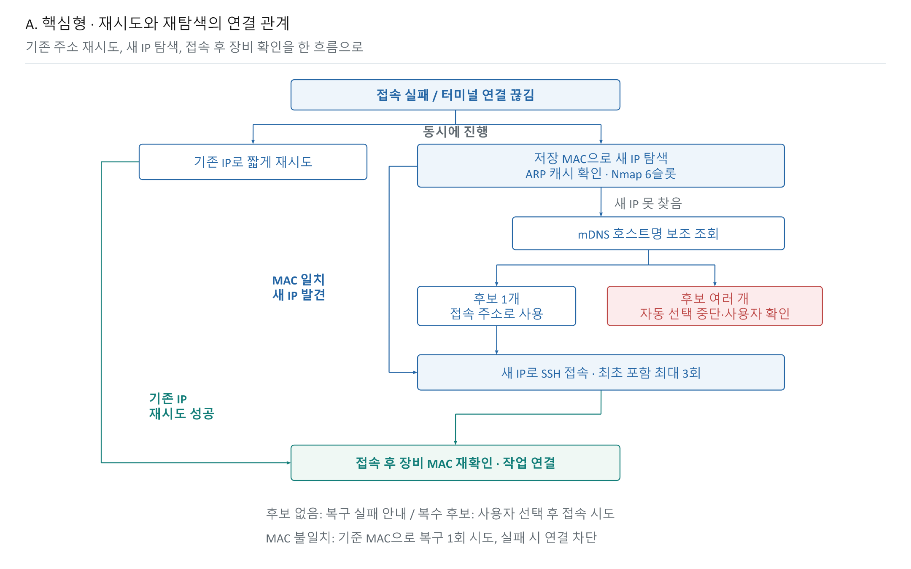

# Clever-Link

**사내 원격지 관리 및 자동 재접속 도구**

병원별 Jetson 장비 정보를 Google Sheets와 연동하고, SFTP 파일 접근과 SSH 터미널을 하나의 Windows 앱으로 통합했습니다. 설치 현장에서 IP 변경으로 연결이 끊겼을 때 원래 장비를 재탐색하고 재접속하도록 구현했습니다.

**인턴 프로젝트 · 단독 개발 · Windows / Jetson Orin Nano 8GB**

## 개발 배경

- 파일 접근과 SSH 접속에 서로 다른 프로그램을 사용하며 장비 정보를 반복 입력해야 했습니다.
- 설치 현장에서 IP가 바뀌면 모니터·키보드 등을 연결해 주소를 직접 확인해야 해 작업이 지연됐습니다.
- 이전 IP가 계속 조회되거나 여러 IP가 같은 호스트명으로 반환되어, 주소 조회나 인증 성공만으로는 의도한 장비인지 판단하기 어려웠습니다.

이러한 현장 경험을 바탕으로 접속 준비를 통합하고, 장비 식별과 연결 복구를 함께 처리하는 업무 도구를 개발했습니다.

## 주요 기능

| 기능 | 구현 내용 |
| --- | --- |
| 시트 기반 장비 관리 | 병동별 목록 구성, 병합 셀·복수 주소 전처리, 누락·변경 안내 |
| SFTP·SSH 통합 | Windows 드라이브 마운트와 앱 내 SSH 터미널 제공 |
| 접속 대상 검증 | 저장된 MAC과 접속 장비의 MAC을 대조해 확인된 불일치에 대응 |
| 연결 복구 | 기존 주소 재시도, ARP 캐시·Nmap 탐색, mDNS 보조 조회 |
| 상태 안내 | 재탐색·복구 성공·대상 불일치·복수 후보를 배너로 표시 |

### 장비 목록과 복구 상태



병동 선택부터 원격 볼륨 조회, 파일 접근, SSH 실행, 장비 정보 수정까지 하나의 목록에서 처리합니다.

### 앱 내 SSH 터미널



등록된 접속 정보를 이용해 장비별 터미널을 실행합니다. 위 화면들은 가상 장비·주소·출력으로 구성한 설명용 예시이며, 실제 운영 장비의 접속 결과가 아닙니다.

## 시스템 구조



프로파일과 인증정보 저장소를 파일 접근·터미널 기능이 공유합니다. 로컬 IP와 터널 주소가 함께 등록된 경우 도달 가능한 접속 경로를 선택합니다. 시트에서 사라진 장비는 즉시 삭제하지 않고 사용자에게 안내하며, 재탐색으로 로컬 접속 주소가 달라지면 시트와의 차이를 알립니다.

## 재탐색·재접속 설계

네트워크 정보의 갱신 시점 자체를 앱이 보장할 수는 없습니다. 따라서 기존 기록이나 호스트명 조회에만 의존하지 않고 후보 IP에 직접 요청하여 응답 MAC을 저장된 기준 MAC과 대조하도록 구성했습니다.



- **빠른 복구 경로:** 재시도 가능한 연결 실패에서 기존 주소의 짧은 재시도와 새 주소 탐색을 함께 진행합니다.
- **MAC 기반 탐색:** ARP 캐시를 먼저 확인하고, 필요한 경우 Nmap으로 후보 IP에 ARP 요청을 보내 IP와 MAC의 대응 관계를 확인합니다.
- **최대 6개 동시 요청:** 후보 목록을 여러 구간에서 교차 투입하고, 한 요청이 끝나면 다음 후보를 바로 확인합니다. 여섯 요청이 모두 끝날 때까지 기다리는 배치 방식은 아닙니다.
- **mDNS 보조 조회:** 새 주소를 찾지 못하면 호스트명으로 조회합니다. 복수 후보는 임의 선택하지 않고 사용자에게 안내합니다.
- **접속 후 검증:** 확인된 MAC 불일치에서는 기준 MAC을 유지한 채 원래 장비의 복구를 시도하고, 복구 실패 시 해당 연결을 차단합니다.

도식은 주요 흐름을 요약한 것입니다. 복수 후보 안내는 해당 탐색 회차의 자동 선택을 보류하며, 별도 재접속 타이머에 의한 이후 탐색까지 영구 중단하지는 않습니다. 인증 오류 등 모든 실패가 재탐색 대상인 것은 아닙니다.

## 업무 적용 및 성과

- **접속 업무 체계화:** 시트 조회·장비 등록·파일 접근·SSH 접속을 하나의 사내 전용 도구로 통합했습니다.
- **현장 주요 업무 지연 완화:** 주변기기를 연결해 IP를 직접 확인하던 수작업을 줄이고, 재탐색·재접속을 자동화했습니다.
- **복구 시간 단축:** 출장 동행 당시 수동 IP 확인과 연결 복구에 **10~20분**이 소요되는 상황을 경험했습니다. 이에 대응하는 기능을 구현했으며, 개발 테스트의 다수 사례에서는 **약 30~40초 이내 재접속**을 확인했습니다.

현장 소요 시간은 출장 동행 시 관찰 기준이고, 앱 복구 시간은 개발 테스트 기준입니다. 동일 조건의 전후 비교나 평균값은 아니며, 1분 이상 걸리거나 복구하지 못한 사례도 있어 항상 일정 시간 이내 복구를 보장하지 않습니다.

## 주요 코드

| 파일 | 역할 |
| --- | --- |
| [app_ui.py](app_ui.py), [index.html](index.html) | 앱 화면과 Python–JavaScript 연동 |
| [sheet_sync.py](sheet_sync.py) | 시트 파싱·전처리·프로파일 동기화 |
| [profile_store.py](profile_store.py) | 프로파일과 keyring 인증정보 관리 |
| [mount_control.py](mount_control.py) | SFTP 드라이브 마운트 |
| [ssh_session.py](ssh_session.py) | SSH 연결·재시도·MAC 검증 |
| [mac_discovery.py](mac_discovery.py) | ARP 캐시·Nmap 기반 MAC 탐색 |
| [mdns_discovery.py](mdns_discovery.py) | 호스트명 기반 보조 조회 |
| [terminal_server.py](terminal_server.py), [terminal.html](terminal.html) | WebSocket 기반 터미널 입출력 |
| [app_config.py](app_config.py) | 공개 코드와 분리한 로컬 설정 로딩 |

## 공개 범위

운영 환경의 시트 URL, 비밀번호, 장비 목록은 포함하지 않습니다. 문서에 등장하는 시설·계정·장비 식별값은 공개용 예시입니다. 현장에서 경험한 문제와 설계 과정은 유지했습니다.

## 실행

1. Python 환경에 `requirements.txt`의 패키지를 설치합니다.
2. Windows에 WebView2 Runtime, WinFsp, Nmap/Npcap을 설치합니다. ARP 탐색에는 로컬 네트워크 접근과 적절한 실행 권한이 필요합니다.
3. 공식 배포처의 `rclone.exe`를 앱 폴더에 준비합니다. 외부 바이너리는 이 저장소에 포함하지 않습니다.
4. `python app_ui.py`로 실행합니다. 시트 설정 없이도 장비를 수동 등록할 수 있습니다.

## 선택 사항: 시트 연동

`config.example.json`을 참고해 앱 폴더에 비공개 `config.json`을 생성합니다. `sheet_csv_url`에는 CSV 내보내기 URL을 설정합니다. `default_password`는 PW 셀이 빈 행에 적용할 선택적 기본값이며, 필요하지 않으면 비워 둡니다.

환경변수 `CLEVER_LINK_SHEET_CSV_URL`, `CLEVER_LINK_DEFAULT_PASSWORD`가 있으면 로컬 설정보다 우선합니다. 설정 변경 후 앱을 재시작합니다. 미설정 상태에서 시트 새로고침을 누르면 설정 안내를 표시합니다.

컬럼: `기기명`, `Ward`, `Room`, `Host name`, `IP`, `ID`, `PW`. 인증정보가 포함된 시트를 공개 링크로 공유하지 마세요. 현재 구현은 지정된 CSV URL을 읽으며 별도의 Google OAuth 흐름은 제공하지 않습니다. 인증이 필요한 조직 시트를 직접 연동하려면 별도의 인증 구현이 필요합니다.

`config.json`, `profiles.json` 및 접속 기록은 Git에서 제외됩니다. 설정 파일의 기본 비밀번호는 평문이므로 로컬 접근 권한을 제한하세요. 등록된 프로파일의 비밀번호는 keyring을 통해 Windows 자격 증명 관리자에 저장합니다.

## 개발·빌드

`requirements.txt`는 코드의 직접 의존성을 정리한 것이며, 특정 버전 조합의 재현 환경은 아닙니다. 빌드에는 별도로 PyInstaller가 필요합니다. 기본 spec은 rclone을 포함하며 OpenSSL DLL을 수동 지정해야 하는 환경에서는 `CLEVER_LINK_OPENSSL_DIR`을 설정할 수 있습니다.

```powershell
python -B -m unittest test_public_config -v
```

공개용 설정 로딩, 환경변수 우선순위, 잘못된 설정 처리, URL 미설정 시 네트워크 요청 방지와 Python 소스 구문을 검사합니다. 이 테스트가 전체 UI·실제 Jetson 연결·배포 빌드 검증을 대신하지는 않습니다.

## 제한 사항

- ARP 기반 MAC 탐색은 같은 로컬 네트워크에 적용됩니다. 인터넷 너머의 장비를 MAC만으로 찾지는 못합니다.
- MAC 검증은 오접속 방지를 위한 보조 장치이며 암호학적 신원 보증이 아닙니다.
- 재접속 시간은 환경에 따라 달라지고, 항상 일정한 시간 이내 복구를 보장하지 않습니다.
- 본 공개용 복사본은 기존 사내 배포 앱 및 실제 운영 설정을 변경하지 않습니다.
